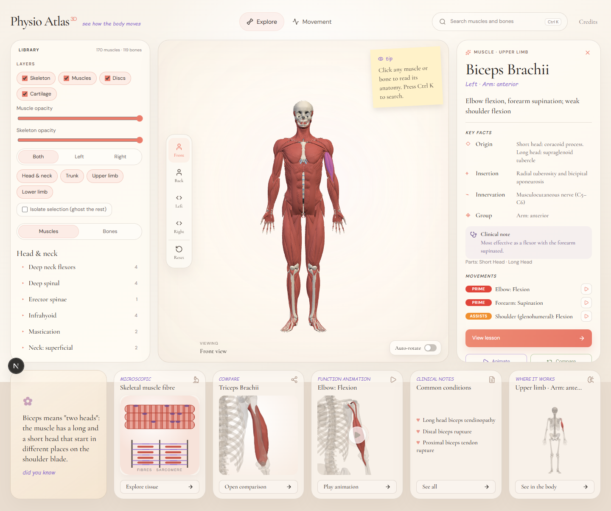
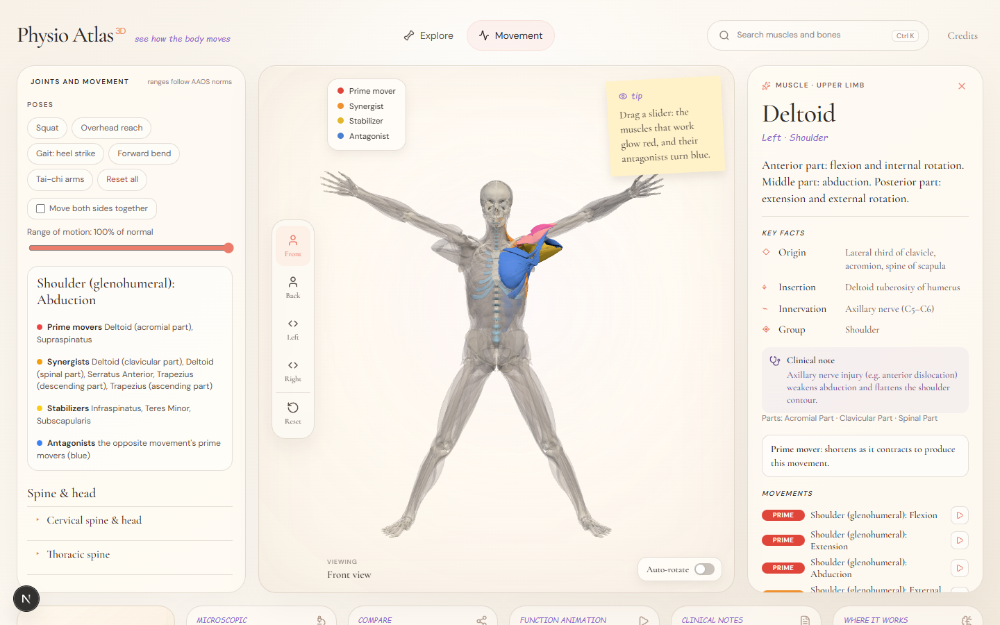
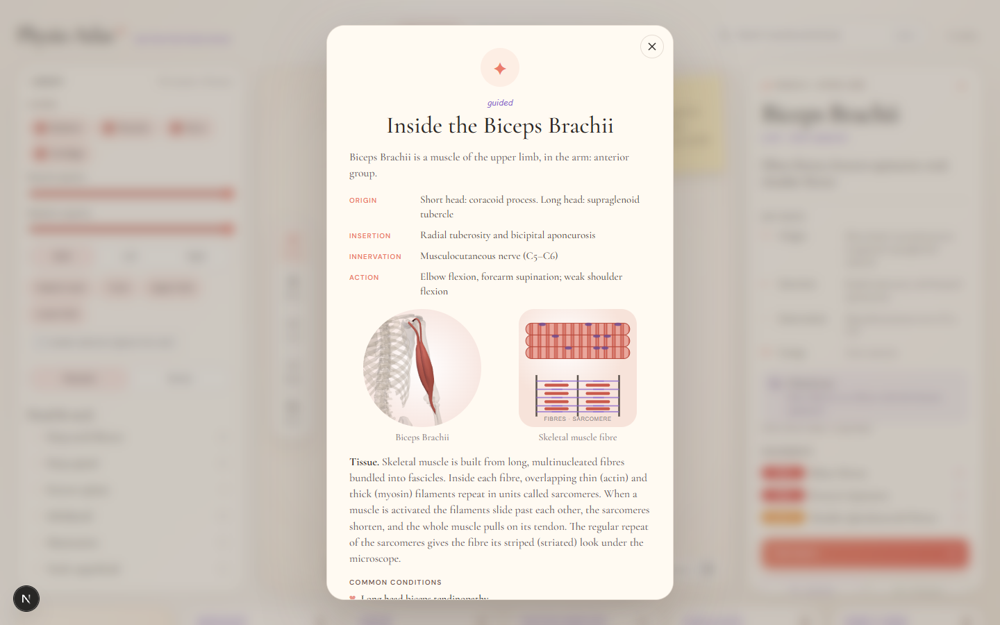
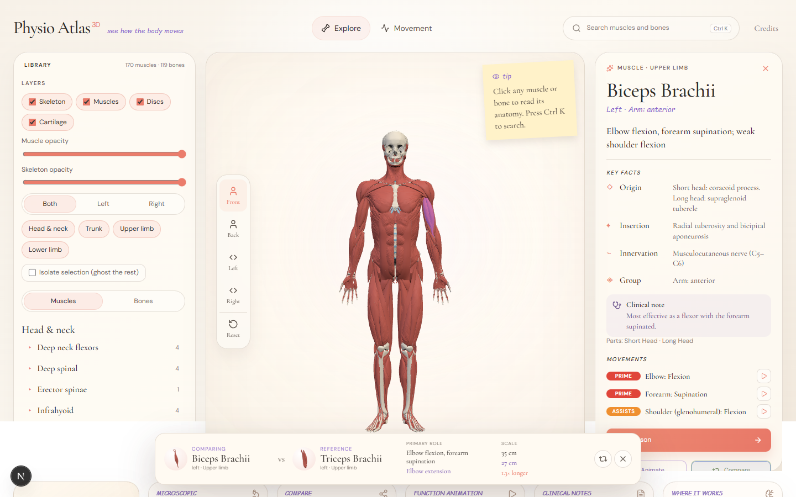
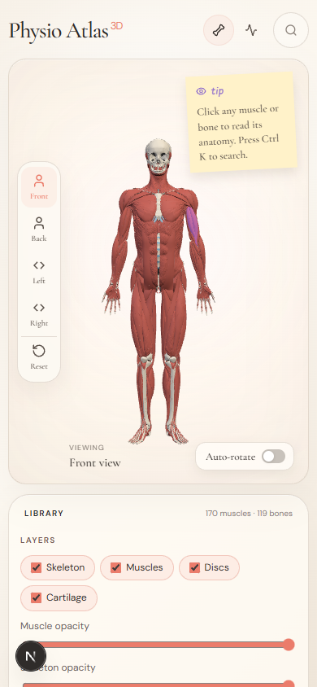

# Physio Atlas

An interactive 3D atlas of the muscles and bones, built for physiotherapy students and clinicians. Explore every
structure, drive each joint through its range of motion, and see which muscles act, and how.



## What it does

- **Explore** 170 muscles and 119 bones (left and right), plus intervertebral discs and costal cartilage. Filter by
  layer, region and side, fade or isolate structures, and search with <kbd>Ctrl</kbd> <kbd>K</kbd>. Selecting a
  structure shows origin, insertion, innervation, action and the movements it takes part in.
- **Move** 16 joints through their ranges (about 40 degrees of freedom, AAOS-style limits). The muscles that act are
  colour-coded as prime mover, synergist, stabilizer and antagonist. You can simulate a restricted joint, play a
  movement through its range, or load a preset such as a squat or a gait step.
- **Study** with a row of learning cards for the selected structure: a fact, the tissue it is made of, a comparison, the
  movement animation, common conditions, and where it sits in the body, plus a compare strip and guided lessons.



| Guided lesson | Compare |
| --- | --- |
|  |  |

The layout works on a phone too:



## Run it

```bash
npm install
npm run dev        # http://localhost:3000
```

The converted 3D models are included in `public/models`, so nothing else is needed. The first build downloads two
Google fonts (Cormorant Garamond and DM Sans), so it needs internet access.

## How it works

- **Models.** The anatomy comes from [BodyParts3D](https://dbarchive.biosciencedbc.jp/en/bodyparts3d/desc.html).
  `scripts/build-models.mjs` classifies the 2,234 source meshes into muscles, bones, discs and cartilage, corrects
  left/right labels that are wrong in the source (54 elements) by checking the geometry, converts to metres / y-up,
  simplifies, and writes Draco-compressed GLB files (about 3 MB in total).
- **Rig.** `app/lib/rig/` defines the skeleton: joint pivots derived from the bone geometry, degrees of freedom with
  range-of-motion limits, a scapulohumeral rhythm, patellar tracking and floor grounding. Muscles are skinned across
  the joints they cross, so they stretch and bend with the skeleton.
- **Clinical data.** `app/lib/data/` holds the origin / insertion / innervation / action text and the table of which
  muscles produce each movement. The movement table is authoritative for a muscle's role; the on-screen length change
  is only shown when the model's geometry agrees with the table.
- **Artwork.** The illustrations on the cards are rendered offscreen from the 3D models and cached. The tissue
  diagrams are hand-drawn SVG.
- **Schematic muscles.** BodyParts3D does not include latissimus dorsi, rectus abdominis, internal oblique,
  transversus abdominis, quadratus lumborum, multifidus, masseter or temporalis. These are generated as approximate
  shells between their real attachment sites and are marked "schematic" in the interface. Facial muscles are not included.

### Rebuilding the models (optional)

1. Download `isa_BP3D_4.0_obj_99.zip` (143 MB, SHA-256 `40665852c49f218326590e204db91064a1ecfc3c6f8cbd7bbbcaac62c7cd409e`)
   and the four `*_parts_list_e.txt` / `*_element_parts.txt` files from
   `https://dbarchive.biosciencedbc.jp/data/bodyparts3d/LATEST/` into `.cache/bp3d/`. The server's certificate chain is
   incomplete, so run node with `--use-system-ca` rather than disabling certificate checks.
2. Extract the OBJ files to `.cache/bp3d/extract/isa_BP3D_4.0_obj_99/`.
3. `npm run models`, then `npm run check`.

### Checks

```bash
npm run typecheck             # TypeScript
npm run check                 # validates the converted models (orientation, left/right pairs, key structures)
npx tsx scripts/check-rig.ts  # joint directions for 14 movements, data keys, no unknown muscles
```

## Limitations

- The clinical text and common-conditions lists are educational summaries written from standard references. They have
  **not been clinically reviewed**. Do not use the atlas for diagnosis or treatment decisions.
- Joint centres are estimated from the bones, and muscle deformation is skinning rather than physics, so angles are
  illustrative. Finger and toe tendons do not follow the digits.
- Estimated muscle length changes ignore wrapping around bones and joints, so they are shown only when they agree with
  the movement table.

## Licences

- The application code has no licence file yet; the repository owner should choose one before the repository is shared.
- The 3D models in `public/models` are adapted from BodyParts3D, © The Database Center for Life Science, licensed under
  [CC BY-SA 2.1 Japan](https://creativecommons.org/licenses/by-sa/2.1/jp/). Because the licence is Share-Alike, the adapted
  models are offered under the same licence. Attribution is also shown in the app at `/attribution`.
