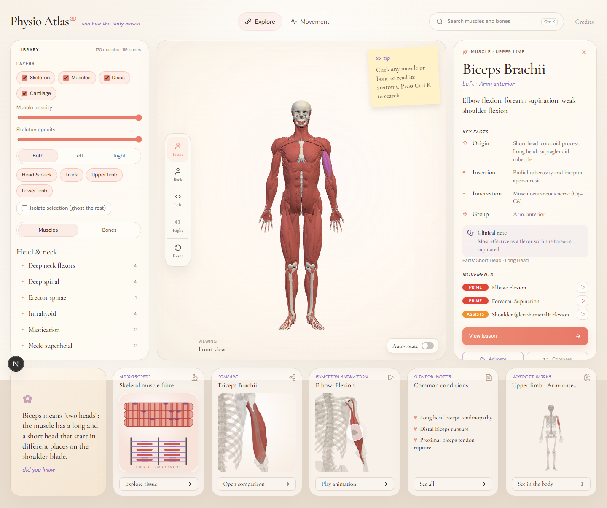
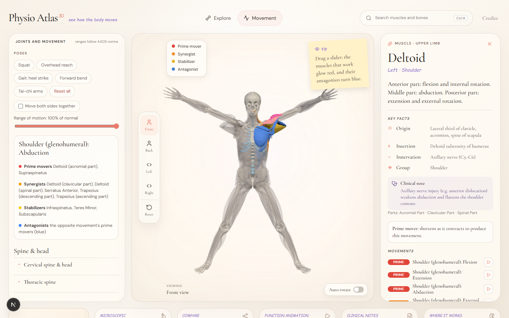
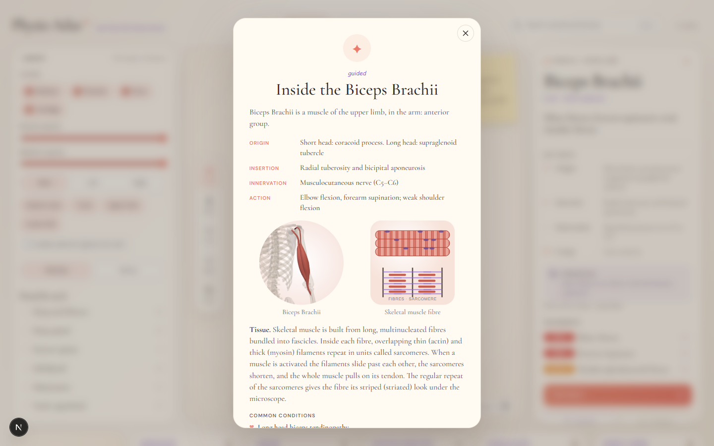
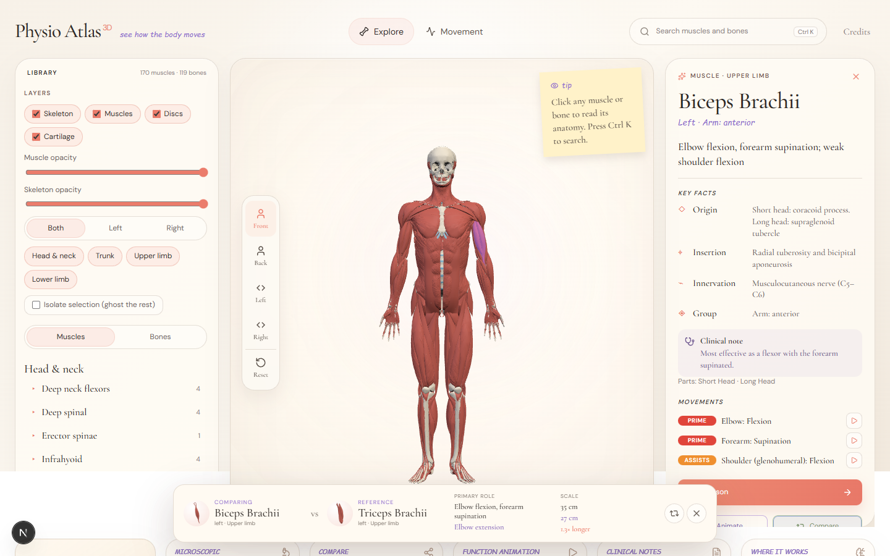
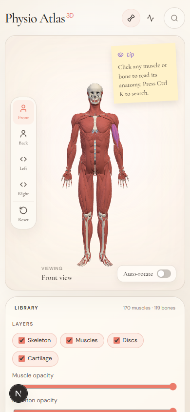

# Physio Atlas

An interactive 3D atlas of the muscles and bones, built for physiotherapy students and clinicians. Explore every
structure, drive each joint through its range of motion, and see which muscles act, and how.



## What it does

- **Explore** 170 muscles and 123 bones (left and right), the articular cartilage of the joints and the menisci,
  labra and joint discs, plus intervertebral discs and costal cartilage. Filter by
  layer, region and side, fade or isolate structures, and search with <kbd>Ctrl</kbd> <kbd>K</kbd>. Long library
  groups (the wrist and hand, the ankle and foot) are split by joint, with a filter box above the list. Selecting a
  structure shows origin, insertion, innervation, action and the movements it takes part in.
- **Nerve supply.** Pick a nerve (radial, femoral, ...) or a spinal root level (C5, L4, ...) in Explore, or click one in a
  muscle's innervation line, to colour every muscle it supplies and fade the rest. It is derived from the innervation text, so
  nothing is added beyond what each entry already says, plus a short branch-to-parent table (posterior interosseous to radial).
- **Move** 16 joints through their ranges (about 40 degrees of freedom, AAOS-style limits). The muscles that act are
  colour-coded as prime mover, synergist, stabilizer and antagonist. You can simulate a restricted joint, play a
  movement through its range, or load a preset such as a squat or a gait step.
- **Study** with a row of learning cards for the selected structure: a fact, the tissue it is made of, a comparison, the
  movement animation, common conditions, and where it sits in the body, plus a compare strip and guided lessons.
- **Quiz** yourself on the same data: name a highlighted muscle or bone, match a muscle to its nerve, an attachment or a
  movement it drives, or find it on the model. Missed questions come back sooner (Leitner boxes, kept in your browser only),
  and the answer is never given away by the info panel, tooltip, screen-reader text or URL until you have answered.



| Guided lesson | Compare |
| --- | --- |
|  |  |

The layout works on a phone too:



## Run it

```bash
npm install
npm run dev        # http://localhost:3000
```

The converted 3D models are included in `public/models`, so nothing else is needed. The first build downloads two
Google fonts (Cormorant Garamond and DM Sans), so it needs internet access.

## How it works

- **Models.** The skeleton, the joint cartilage (articular cartilage, menisci, labra, joint discs), the intervertebral
  discs, the costal cartilage, the limb muscles with their tendons (98 of the 170 muscles, with their fibre
  textures) and the ligaments, joint capsules, bursae, tendon sheaths, retinacula and fasciae of the limbs and pelvis
  come from the [Open 3D Model](https://anatomytool.org/open3dmodel) (AnatomyTOOL); the trunk, neck and head
  muscles, deltoid, pectoralis major, trapezius (all three shown in parts the Open 3D Model does not separate), adductor
  pollicis, adductor minimus, coccygeus and the hyoid come from
  [BodyParts3D](https://dbarchive.biosciencedbc.jp/en/bodyparts3d/desc.html). `public/models/ATTRIBUTION.md` lists which
  muscle comes from where; the structure panel shows each structure's source.
  `npm run models` runs two stages:
  1. `scripts/build-models.mjs` builds the BodyParts3D set (classification of the 2,234 source meshes, left/right fixed
     from the geometry, metres / y-up, simplification) into `.cache/build/bp3d`. Run on its own with its defaults it still
     writes the previous BodyParts3D-only set to `public/models`, byte for byte (`npm run models:bp3d`).
  2. `scripts/build-open3d.ts` checks the SHA-256 of the three Open 3D Model files, cleans their object names
     (zero-width characters, tabs, typos: `scripts/lib/open3d.ts`), classifies the objects, maps the bones onto the
     existing structure keys, decides each object's side from its geometry (many right-side objects carry no ".r"),
     mirrors the right side to make the left (winding flipped; normal maps work unchanged because the viewer derives
     the tangent frame from the UVs), moves everything into the app frame standing on y = 0, splits cartilage that
     covers several bones per bone, fits spheres to the humeral and femoral heads and the elbow and knee surfaces for the
     rig, places the Open 3D Model limb muscles and tendons (`MUSCLE_TABLE` in `scripts/lib/open3d.ts` maps each object
     to a muscle and part of the atlas; tendons become parts of their muscle, the fibre textures are embedded once and
     shared by both sides), and carries the remaining BodyParts3D muscles onto the new bones: each rig segment's old bones are fitted to the new
     ones (rigid + stretch), the fits are blended with the muscle's own skin weights, the muscle follows local changes of
     the bone surface beneath it, and anything left inside a bone is pushed out and smoothed. The schematic muscles are
     regenerated against the new bones. The ligaments, capsules, bursae, sheaths, retinacula and fasciae are mapped by
     `SOFT_TABLE` / `OVERLAY_TABLE` (every other object is in a skip list with its reason, and the build stops on any
     object in neither), split per digit where one object holds several, and fixed to the bones they touch; their
     proximity skin (below) is computed here and stored in the file. It writes `skeleton.glb` (bones with their normal
     maps, discs, costal cartilage), `joints.glb` (articular cartilage and fibrocartilage), `muscles.glb`,
     `ligaments.glb` (the soft tissue of the joints, loaded after the first paint) and `structures.json`, about
     9.5 MB in total. Ligaments that the source draws only as thin highlight sheets are given thickness (0.7 to 2.5 mm,
     by a rule of thumb, growing away from the bone). At the end of the build the stored meshes are thinned to a
     density that moves no surface by more than 0.4 mm, and the textures are stored as WebP at the size the viewer
     uses (this step needs `sharp`; without it the source images are stored unchanged). `npm run models:report` measures how the muscles sit on the bones before and after.
- **Rig.** `app/lib/rig/` defines the skeleton: joint pivots derived from the bone geometry (the build fits spheres or
  hinge circles to the articular cartilage: the humeral and femoral heads, the elbow and knee hinges, the heads of the
  metacarpals, metatarsals and finger phalanges, and the mandibular condyles), shoulder and hip rotation about the
  bone's own long axis, degrees of freedom with range-of-motion limits, a scapulohumeral rhythm, patellar tracking and floor grounding. Muscles are skinned across
  the joints they cross, so they stretch and bend with the skeleton. The Open 3D Model muscles are skinned as a whole
  (heads and tendons share one line of action), and their tendons follow the bones they reach beyond the muscle's
  chain: the finger and toe phalanges, the foot below the ankle and the patella (`skinParts` in
  `app/lib/rig/skinning.ts`). Ligaments, capsules, sheaths, retinacula and fasciae that span a joint are blended
  between the bones they are fixed to by proximity (`skinAttach`): the attachments stay rigid on their bone, and the
  weights in between are the smoothest field close to each vertex's share of distance to the bones. At the shoulder,
  elbow, hip and knee the blend runs through three intermediate "arc" nodes that turn by a quarter, a half and three
  quarters of the joint's rotation, so the mid part of a capsule goes round the joint surface instead of cutting
  through it, and vertices lying over a turning joint surface slide on it rather than stick to it. The build poses each
  such capsule through its joint's range and bounds how far along the arc a vertex may lag where it would otherwise
  sink into a bone (the back of the knee, the front of the elbow); the capsules and tendon sheaths of the fingers and
  toes are bounded the same way at each joint of the digit (including a full fist), without arc nodes, as far as that
  neither tears nor folds a sheath. Bursae and the
  ligaments between bones that move together are rigid with one bone. The wrist bends at two levels (radiocarpal and
  midcarpal, half of the movement each).
- **Clinical data.** `app/lib/data/` holds the origin / insertion / innervation / action text and the table of which
  muscles produce each movement. The movement table is authoritative for a muscle's role; the on-screen length change
  is only shown when the model's geometry agrees with the table.
- **Nerve layer and sources.** `app/lib/nerves.ts` parses each muscle's innervation string into nerves and root levels
  (with a small branch-to-parent table), and the filter is part of the shareable URL. `app/lib/data/sources.ts` is a registry
  of standard references; a muscle's optional `refs` and `reviewed` fields record what it was checked against. None has been
  checked yet, and the info panel says so.
- **Artwork.** The illustrations on the cards are rendered offscreen from the 3D models and cached. The tissue
  diagrams are hand-drawn SVG.
- **Schematic muscles.** BodyParts3D does not include latissimus dorsi, rectus abdominis, internal oblique,
  transversus abdominis, quadratus lumborum, multifidus, masseter or temporalis. These are generated as approximate
  shells between their real attachment sites and are marked "schematic" in the interface. Facial muscles are not included.

### Rebuilding the models (optional)

1. BodyParts3D: download `isa_BP3D_4.0_obj_99.zip` (143 MB, SHA-256 `40665852c49f218326590e204db91064a1ecfc3c6f8cbd7bbbcaac62c7cd409e`)
   and the four `*_parts_list_e.txt` / `*_element_parts.txt` files from
   `https://dbarchive.biosciencedbc.jp/data/bodyparts3d/LATEST/` into `.cache/bp3d/`. The server's certificate chain is
   incomplete, so run node with `--use-system-ca` rather than disabling certificate checks. Extract the OBJ files to
   `.cache/bp3d/extract/isa_BP3D_4.0_obj_99/`.
2. Open 3D Model: download `overview-skeleton.glb`, `upper-limb.glb` and `lower-limb.glb` from
   `https://caskanatomy.info/open3dviewer/3dmodels/<name>/<name>.glb` to `.cache/open3d/dl/cask/<name>/<name>.glb`. The
   build checks their SHA-256 (listed in `scripts/lib/open3d.ts`) and stops with these instructions if a file is missing
   or different.
3. `npm run models` (about 2 to 3 minutes: the soft-tissue skins are shared out between up to 8 processes;
   `O3D_SKIN_SHARDS=1` runs them in one, about 6 minutes), then `npm run check` and `npm run check:rig`. `SKIP_BP3D=1` reuses
   stage 1, `MODELS_OUT=<dir>` writes elsewhere.

### Checks

```bash
npm test                      # typecheck + check + check:rig + test:unit in one go
npm run typecheck             # TypeScript
npm run lint                  # ESLint (Next + TypeScript rules); warnings are advisory, errors fail
npm run check                 # validates the converted models (orientation, left/right pairs, key structures)
npm run check:rig             # joint directions for 14 movements, data keys, no unknown muscles
npm run test:unit             # Vitest unit tests in tests/ (roles, catalog, movement table, search)
npm run format:check          # Prettier (npm run format to apply)
```

The same checks (plus a production build) run in GitHub Actions on every push and pull request
(`.github/workflows/ci.yml`). The unit tests use the real `public/models/structures.json` manifest as fixture data, so they
also catch movement-table entries that name a muscle or part that does not exist.

## Limitations

- The clinical text and common-conditions lists are educational summaries written from standard references. They have
  **not been clinically reviewed**. Do not use the atlas for diagnosis or treatment decisions.
- Joint centres are estimated from the bones, and muscle deformation is skinning rather than physics, so angles are
  illustrative. The BodyParts3D muscles' tendons (adductor pollicis, the trunk) do not follow the digits; the Open 3D
  Model tendons do, by bone proximity, which is approximate over the knuckles and the patella in deep flexion.
- The trunk, neck and head muscles are BodyParts3D shapes carried onto the Open 3D Model bones by a fit, so a few still
  graze or cut a bone corner (about 0.1 % of all muscle surface lies more than 2 mm inside a bone). A tendon shared by
  several muscles (calcaneal, quadriceps, pes anserinus) is shown with one of them. The joint
  cartilage and menisci are rigid with one bone each; they do not deform when the joint moves.
- Ligaments and capsules bend by blending between their bones, not by simulation: they do not wrap, and the only
  folding is a built-in one at the elbow. The shoulder and hip capsules stay on the humeral and femoral heads, and the
  model build keeps the capsules of the shoulder, elbow, hip and knee out of the bones through the range by moving
  vertices along the joint's arc, and the digit capsules and tendon sheaths by bounding each joint's blend (along a
  sheath only as far as that does not fold it; in a fist up to about 17 % of a synovial sheath's edges fold by more
  than 60 degrees, and the index finger's synovial sheath still cuts across the front of the MCP joint); at the elbow, where that is not enough, the front of the capsule is pushed out from
  the hinge axis as the elbow bends, so it bunches forward instead of entering the coronoid and the radial head. What is
  left: in deep knee flexion (130 degrees) about 1 % of the knee capsule still dips up to 3.5 mm into the back of the
  tibial plateau and the capsule creases where it is compressed behind the joint; at full elbow flexion (150 degrees)
  about 4 % of the elbow capsule (138 of 3190 vertices) still enters bone (up to 5 mm), and the bunched front is still creased (about 14 %
  of its edges fold by more than 60 degrees); the knee capsule's attachments drift up to about 24 mm from their bone in
  deep flexion (the price of keeping it out of the bones; the knee's synovial membrane is back to about 100 vertices
  newly in bone over the range); and the inferior glenohumeral ligament, which has no slack in the source mesh, spans
  up to about 1.5 times its resting length between its farthest points in full elevation (about 1.9 times in an
  axis-aligned bounding box, which also grows as the strap turns; its humeral attachment swings round the head, nothing
  tears). The index finger's synovial sheath in a fist is not fixed: it still cuts across the front of the MCP joint
  and the sheaths show small webs at the middle and ring MCP. About 40 ligaments that
  the source draws only as highlight outlines are shown as slabs whose thickness is a rule of thumb, not a measurement.
  The soft-tissue descriptions have not been checked against a reference yet.
- Estimated muscle length changes follow a straight line between the attachment points, bent only where the muscle data
  names a bone it runs over: `strainWrap` (the patella for the quadriceps, the carpus for the wrist extensors) or
  `strainVias` (landmarks found from the bone's shape, such as the back of the malleoli for the ankle tendons, the front
  of the femoral head for the iliopsoas), which are fixed points on the bones.
  `strainVias` may also name wrapping surfaces: cylinders along a joint's axis (the backs of the knuckles and of the
  finger and thumb joints, the palmar side of the wrist, the metatarsal heads under the long toe flexors, the humeral shaft under teres
  major), which the line wraps over only where it would otherwise cut through them. A few muscles take an end from a
  bone landmark instead of the mesh (`strainOrigin`/`strainInsertion`: the masseter, the upper fibres of pectoralis
  major). The deltoid and pectoralis major, whose parts the movement table gives different roles, have one line per part
  (`strainParts`: bone landmarks at both ends, wrapping over a sphere round the humeral head) and a table row is read on
  the line of the part it names; the pectoralis major's clavicular line is tuned to shorten in flexion and is only as
  good as its landmarks. Every other muscle is still one line, so a fan-shaped muscle whose parts act differently
  cannot agree with every row of the table, and the joints are pure
  rotations about fixed pivots (no gliding, e.g. no condylar translation as the mouth opens), which wrapping cannot make
  up for. A read-out is shown
  only when it agrees with the movement table; run `npx tsx scripts/strain-report.ts --list` to see where it does not.

## Contributing

Contributions are welcome, especially corrections to the clinical content. See [CONTRIBUTING.md](CONTRIBUTING.md).

## Licences

- The application code is released under the [MIT License](LICENSE).
- The bones, joint cartilage, discs, costal cartilage, the limb muscles and tendons, and the ligaments, capsules,
  bursae, sheaths, retinacula and fasciae in `public/models` are adapted from the
  [Open 3D Model](https://anatomytool.org/open3dmodel) (AnatomyTOOL consortium; project lead Paul Gobée, modellers Eungyeol
  Lee and Emily Fong and contributors, see `public/models/ATTRIBUTION.md`), which as far as we could establish derives from
  Z-Anatomy and BodyParts3D. It is licensed [CC BY-SA 4.0](https://creativecommons.org/licenses/by-sa/4.0/) and the adaptations are offered on the
  same terms.
- The other muscles (trunk, neck and head; deltoid, pectoralis major, trapezius, adductor pollicis, adductor minimus,
  coccygeus) and the hyoid are adapted from BodyParts3D, © The Database Center for Life Science, licensed under
  [CC BY-SA 2.1 Japan](https://creativecommons.org/licenses/by-sa/2.1/jp/). Because the licence is Share-Alike, the adapted
  models are offered under the same licence.
- Attribution is also shown in the app at `/attribution` and ships next to the models in `public/models/ATTRIBUTION.md`.
